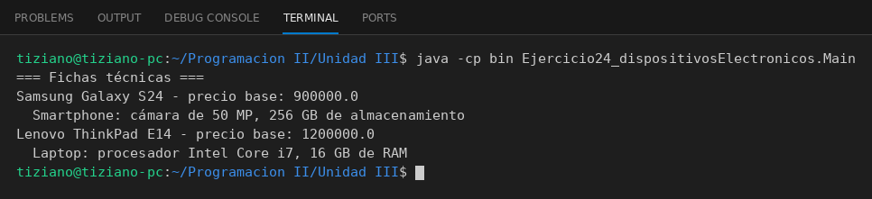

# Dispositivo

Programación II - Unidad 3 - Ejercicio 24

## Consigna
Modelar una jerarquía de clases con herencia: una clase base y subclases que reutilizan código con `super` y sobrescriben métodos. Un catálogo de dispositivos electrónicos.

## Lógica
- `Dispositivo` con marca, modelo y precio base.
- `Smartphone` (megapíxeles, almacenamiento) y `Laptop` (procesador, RAM).
- Cada una reescribe `mostrarInformacion()` con `super` más sus datos técnicos.
- `Main` imprime las fichas técnicas.

## Ejecución

